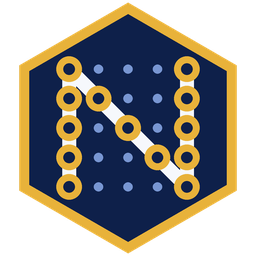

# NumFranc (NFR)

**La monnaie numérique post-quantique, minée par des ordinateurs ordinaires.**

   

[Site](https://shadowrook-crypto.github.io/NumFranc/) · [Comment ça marche](https://shadowrook-crypto.github.io/NumFranc/comment-ca-marche.html) · [Post-quantique](https://shadowrook-crypto.github.io/NumFranc/post-quantique.html) · [Questions](https://shadowrook-crypto.github.io/NumFranc/faq.html) · [Livre blanc](https://shadowrook-crypto.github.io/NumFranc/LIVRE_BLANC.pdf) · [English](https://shadowrook-crypto.github.io/NumFranc/en.html)

*English: NumFranc is a cryptocurrency written in Rust, with post-quantum ML-DSA-87 signatures, memory-hard Argon2d proof of work, a fixed 69.1 M cap and a single program (node + miner + wallet + GUI). Built with the help of Claude (Anthropic). Software provided **without warranty** (MIT licence). NumFranc aims to become a leading post-quantum payment infrastructure, used by individuals and businesses alike. Open-source software under development: no NFR for sale, no promise of value.*

Cryptomonnaie à preuve de travail, avec signatures **post-quantiques ML-DSA-87** dès le premier bloc.
Écrite en Rust, un seul programme : nœud réseau + minage + portefeuille.

> **NumFranc a l'ambition de devenir une infrastructure de paiement post-quantique de référence, utilisée par les particuliers comme par les entreprises. Logiciel libre en développement : aucune vente de NFR, aucune promesse de valeur.**
>
> Logiciel fourni sans garantie (licence MIT). NumFranc n'a aucun lien avec un État ou une banque.

## Installer (sans terminal)
Page de téléchargement : https://shadowrook-crypto.github.io/NumFranc/ (français et anglais).

| Système | Fichier | Installation |
|---|---|---|
| Mac | `NumFranc-macos.dmg` | double-clic, glisser NumFranc vers Applications, ouvrir depuis le Launchpad (la 1re fois : Réglages Système > Confidentialité et sécurité > « Ouvrir quand même » ; macOS 14 et plus ancien : clic droit > Ouvrir) |
| Windows | `NumFranc-windows-installation.exe` | double-clic, « Suivant » (si SmartScreen : Informations complémentaires > Exécuter quand même) |
| Linux | `NumFranc-linux-amd64.deb` ou `-arm64.deb` | double-clic, ou `sudo apt install ./NumFranc-linux-amd64.deb` |

*English: download `NumFranc-macos.dmg`, `NumFranc-windows-installation.exe` or the `.deb` for your system from the latest release, double-click, done. NumFranc is not affiliated with any state or bank.*

Chaque version est signée (SLH-DSA) : `SHA3SUMS.txt` contient aussi les empreintes des installeurs (lignes `installeurs/…`) ; pour en vérifier un :
`python3 sha3sum.py --fichier SHA3SUMS.txt NumFranc-macos.dmg` (outil fourni dans `NumFranc.zip`).

## Paramètres
| Paramètre | Valeur |
|---|---|
| Plafond | 69 100 000 NFR (1 NFR = 10^8 unités minimales, aucun nombre à virgule) |
| Temps par bloc | 691 secondes |
| Palier | 100 000 blocs (environ 2,19 ans) |
| Récompense | 6,91 NFR (palier 0), 69,10 NFR (palier 1), puis -10 % par palier |
| Fin de l'émission | bloc 4 471 948 (palier 44, environ 97,9 ans) |
| Hachage | double SHA3-512 (FIPS 202) : identifiants, Merkle, adresses |
| Preuve de travail | Argon2d (RFC 9106), 4 Mio de mémoire par essai : gourmande en mémoire, pensée pour les processeurs ordinaires |
| Signatures | ML-DSA-87 (FIPS 204, niveau 5), crate `fips204` |
| Difficulté | réajustée tous les 691 blocs, variation bornée à x4 |
| Taille de bloc | 8 Mio maximum |
| Port réseau | 6910 |

## Sécurité

**Post-quantique**
- Signatures ML-DSA-87 (standard NIST), bibliothèque publiée, jamais une implémentation maison.
- Une adresse = les 256 premiers bits de SHA3-512(clé publique), écrite en base 32 : `NFR1-XXXX-…` (77 caractères, somme de contrôle incluse). La clé n'est révélée qu'au moment de dépenser.
- Chaque sortie porte un verrou : 0 = libre, < 500 000 000 = numéro de bloc, sinon date Unix comparée au temps médian des 11 derniers blocs (comme Bitcoin, BIP 113). Chaque transaction peut porter un message public signé de 140 octets au plus.
- Taille d'une transaction 1 entrée / 2 sorties : 7 390 octets (sortie : 45 octets).
- ML-DSA étant sans état, l'adresse principale du portefeuille est permanente ; la monnaie rendue part vers une adresse neuve.
- Chaque récompense de minage arrive sur une adresse neuve.

**Contre l'attaque des 51 %**
Aucune règle ne rend une petite blockchain invulnérable : la vraie protection, c'est beaucoup de mineurs indépendants.
NumFranc limite les dégâts possibles :
1. **Finalité à 10 blocs** : un nœud refuse toute réécriture de plus de 10 blocs (environ 1 h 55), même si la chaîne concurrente a plus de travail. Un attaquant qui mine en secret ne peut plus effacer l'historique ancien.
2. **Choix par travail cumulé**, pas par longueur : une longue chaîne facile à miner ne gagne pas.
3. **Points de contrôle** inscrits dans le logiciel à chaque version.
4. **Maturité de 100 blocs** pour les récompenses de minage.
5. **Horodatage contrôlé** (temps médian des 11 derniers blocs, pas plus de 2 h dans le futur) contre la manipulation de la difficulté.
6. **Exclusion 24 h** des pairs qui envoient des blocs ou messages invalides.
7. Conseil affiché : attendre **6 confirmations** avant de considérer un paiement comme sûr.

Limite connue : si le réseau est coupé en deux pendant plus de 10 blocs, les deux moitiés ne se rejoignent pas automatiquement (il faut une intervention).

**Contre la centralisation du minage**
- La preuve de travail Argon2d oblige chaque essai à remplir puis relire 4 Mio de mémoire dans un ordre imprévisible. Les puces spécialisées (ASIC) et les cartes graphiques perdent l'essentiel de leur avance : un PC ordinaire reste compétitif. Bitcoin, lui, est miné presque uniquement par des ASIC.
- Implémentation `argon2` du projet RustCrypto (pur Rust, aucune dépendance C), donc la même sur Mac, Windows et Linux.
- RandomX (Monero) va plus loin, mais exige une bibliothèque C++ et 2 Gio de mémoire : incompatible avec une installation en un clic sur toutes les machines.

**Portefeuille**
- Fichier `wallet.dat` en deux sections, chacune chiffrée deux fois (AES-256-GCM puis XChaCha20-Poly1305, deux clés indépendantes de 256 bits tirées d'Argon2id : 256 Mio × 3 passes pour la vue, 1 Gio × 4 passes pour le coffre) :
  la « vue » (adresses, carnet) s'ouvre avec le mot de passe d'ouverture ; le « coffre » (la graine) avec le code de dépense, uniquement le temps de signer.
- 1 000 adresses calculées à l'avance : miner et recevoir ne demandent jamais la graine.
- Code de secours en 3 morceaux (partage de Shamir 2 sur 3 sur GF(256)), avec somme de contrôle et identifiant du portefeuille.
- Carnet d'adresses chiffré ; empreinte visuelle de chaque adresse (4 mots + couleur) contre les virus qui remplacent une adresse copiée.

**Stockage**
- Chaque nœud garde tous les blocs dans `blocks.dat` et les relit à la demande : seuls les en-têtes et l'ensemble des pièces non dépensées (UTXO) restent en mémoire.
- Au démarrage, les blocs du fichier (déjà vérifiés par ce nœud) sont revérifiés sauf la preuve de travail et les signatures, ce qui rend le démarrage rapide. Une fin de fichier abîmée (coupure de courant) est réparée automatiquement.
- Les réorganisations (au plus 10 blocs) utilisent des données d'annulation : pas besoin de tout recalculer.

**Contre la falsification du logiciel**
- Code public et vérifiable.
- Chaque version publiée est accompagnée d'empreintes **SHA3-512** (`SHA3SUMS.txt`, vérifiables avec `python3 sha3sum.py --check SHA3SUMS.txt`), la même famille de hachage que le reste de NumFranc. Chaque version est aussi **signée** (`SHA3SUMS.txt.sig`, SLH-DSA-SHAKE-128s, norme FIPS 205) : la signature prouve que le manifeste vient de l'auteur, pas d'un tiers. Les transactions, elles, restent en ML-DSA-87.
- **Compilation reproductible** : `./scripts/build-reproductible.sh CIBLE` (ex. `x86_64-unknown-linux-gnu`) doit redonner exactement le même programme que celui publié (vérifié pour Linux x86-64) ; comparez l'empreinte affichée avec la ligne correspondante de `SHA3SUMS.txt`. La CI le vérifie à chaque version en compilant deux fois.
- **Mises à jour** : le bouton « Vérifier les mises à jour » (Réglages) ne propose une nouvelle version que si sa signature est valide.

**Fonctions de la v0.6**
- **Pseudos** `nom.nfr` inscrits dans la chaîne (3 à 32 caractères, frais uniques selon la longueur), transférables.
- **Paiements annulables** : sorties « retenues » que l'expéditeur (ou un gardien) peut reprendre avant une date de déblocage ; réglage par seuil et délai dans le portefeuille.
- **Multi-signature M sur N** (jusqu'à 15 membres), avec signatures ML-DSA et propositions à signer à tour de rôle.
- **Gel du portefeuille** : la graine est effacée de l'ordinateur ; dégel avec mot de passe d'ouverture, nouveau code de dépense et 2 morceaux de secours.
- Demande de paiement (lien `nfr:` cliquable sur Windows et Linux, et QR code), preuve de réserve, tableau de bord de l'émission, mode explication pas à pas, démarrage automatique, verrou d'instance unique.
- Protocole 4 : **nouvelle chaîne**, incompatible avec les versions précédentes. Une ancienne `blocks.dat` est mise de côté automatiquement.

**Interface (v0.5)**
- Fenêtre en français ou en anglais, thème clair ou sombre, 6 couleurs au choix.
- Graphique des gains de minage (7 ou 30 jours), explorateur de blocs, export de l'historique en CSV.
- Minage selon un horaire (nuit / jour), icône dans le menu des applications (Linux, macOS, Windows).

**Tests de résistance**
- `cargo run --release --example fuzz -- 3000000` : 3 millions d'entrées abîmées ou aléatoires envoyées à tous les décodeurs (transactions, blocs, messages réseau, adresses, montants, morceaux de secours). Aucun plantage.

**Nœud permanent**
- `numfranc --serveur` : nœud sans portefeuille, sans fenêtre et sans minage, avec service systemd (voir `SERVEUR.txt`).

## Utilisation
Voir `LISEZMOI.txt` dans le paquet téléchargeable. En résumé : double-clic sur le lanceur ;
une fenêtre s'ouvre (egui, pur Rust). Mode texte avec `--console`, puis commandes `statut`, `solde`, `adresse`, `envoyer ADRESSE MONTANT [verrou DURÉE] [message TEXTE]`, `historique`, `pairs`, `minage on/off`, `secours`.

Options : `--pair HÔTE:PORT`, `--port N`, `--coeurs N`, `--sans-minage`, `--dossier CHEMIN`, `--console`.

## Développement
    cargo test --release          # 75+ tests (émission, signatures, double dépense, attaques...)
    cargo build --release         # programme dans target/release/numfranc
    ./scripts/make-dist.sh        # assemble le dossier à distribuer dans dist/NumFranc

Compilation pour toutes les plateformes : pousser le dépôt sur GitHub puis créer un tag `v0.6.0`.
Le fichier `.github/workflows/release.yml` compile pour Mac (Apple Silicon et Intel), Linux (x86_64 et ARM)
et Windows, puis publie `NumFranc.zip`.

## Structure du code
| Fichier | Rôle |
|---|---|
| `config.rs` | toutes les constantes |
| `emission.rs` | récompense par bloc et plafond |
| `hashing.rs`, `merkle.rs` | SHA3-512, arbre de Merkle |
| `signature.rs` | ML-DSA-87 |
| `tx.rs`, `block.rs` | formats binaires des transactions et des blocs |
| `chain.rs` | validation, choix de chaîne, protections anti-51 %, stockage |
| `mempool.rs` | transactions en attente |
| `wallet.rs` | portefeuille déterministe (code de secours) |
| `p2p.rs`, `node.rs` | réseau, synchronisation, minage multi-cœurs |
| `main.rs` | console en français |

## Feuille de route
- [x] Émission, hachage, en-tête de 212 octets, preuve de travail
- [x] Transactions UTXO signées ML-DSA-87, Merkle, validation complète
- [x] Protections anti-51 % (finalité, travail cumulé, maturité, horodatage)
- [x] Stockage, réseau P2P, synchronisation, découverte des nœuds (réseau local, annuaire mondial DHT)
- [x] Portefeuille chiffré avec code de secours en 3 morceaux, minage multi-cœurs, console
- [x] Interface graphique (6 onglets, mode expert), liens de paiement `nfr:`
- [x] Signature des versions (SLH-DSA), vérification des mises à jour, compilations reproductibles
- [x] Audit de sécurité et corrections « comme Bitcoin » (v1.0)
- [x] Ouverture automatique du port (UPnP, NAT-PMP, PCP) avec message d'état et guide de réglage universel, 6 langues, installeurs Mac / Windows / Linux (v1.1)
- [x] Nœud permanent Linux en une commande, qui se relance tout seul (v1.1.2)
- [x] « Toujours allumé » sur Mac, Windows et Linux : démarrage avec l'ordinateur, arrière-plan, relance automatique (v1.2.0)
- [x] Mise à jour automatique en un clic, vérifiée deux fois, et alerte de faille (v1.2.2)
- [x] Audit de sécurité complet et corrections (v1.2.3)
- [x] Points de contrôle, gardien qui rembourse l'expéditeur, frais de pseudo détruits (v1.3.0, actif le 9 novembre 2026)
- [x] Protection renforcée contre les attaques à 51 % : chaînes cachées pénalisées, 30 confirmations pour les gros paiements (v1.4.0)
- [ ] Plusieurs nœuds d'amorçage tenus par des personnes différentes (`DEFAULT_SEEDS`, en plus de l'annuaire mondial)
- [ ] Synchronisation « headers-first »
- [ ] Interface RPC locale (port 6911) pour une future passerelle d'échange
- [ ] Installeurs signés par Apple et Microsoft (comptes payants)
- [ ] Audit de sécurité par un spécialiste humain

## Signature des versions
    cargo run --release --example signer_version -- keygen MACLE     # une fois ; MACLE.key reste SECRET
    cargo run --release --example signer_version -- signer SHA3SUMS.txt MACLE.key
    cargo run --release --example signer_version -- verifier SHA3SUMS.txt SHA3SUMS.txt.sig MACLE.pub
La clé publique (`MACLE.pub`) est committée dans `packaging/cle-publique.txt`. La clé secrète n'est jamais dans le dépôt.

Sur le Mac de l'auteur, une seule commande fait tout (attente de la CI, Wi-Fi coupé pendant la signature, clé effacée, envoi et vérification) :

    ./scripts/signer-version.sh 1.1.0

## Licence et origine
Code publié sous licence MIT (voir `LICENSE`). Créé par ShadowRook, avec l'aide de l'IA Claude (Anthropic) pour la conception et l'écriture du code. Aucune garantie.
